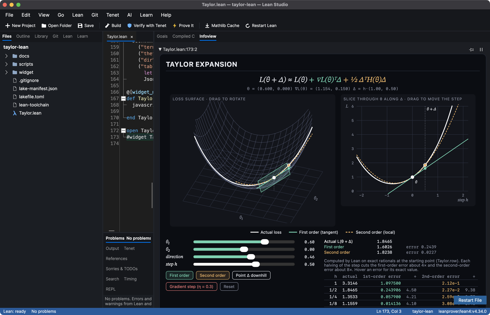

# What the gradient is doing

A Taylor expansion you can drag around, with every claim proved in Lean.



Near a point θ, a loss looks like its value, plus the gradient dotted with the step, plus half the step's
quadratic form under the Hessian:

    L(θ + Δ) ≈ L(θ) + ∇L(θ)ᵀΔ + ½ ΔᵀH(θ)Δ

This project takes one loss surface in two parameters and proves that exactly, over the rationals, in core
Lean with no Mathlib, so it opens in seconds. The widget lets you rotate the surface, move the point, change
the direction and size of the step, and take gradient-descent steps, while it shows the true loss (white), the
first-order model (teal) and the second-order model (orange).

## Try it in Lean Studio

1. Install [Lean Studio](https://github.com/keithadler/leanstudio) (on a Mac: `brew install --cask keithadler/tap/lean-studio`).
2. Clone this repository and open the folder: **Open Folder**, then pick `taylor-lean`.
3. Open `Taylor.lean`, click on the last line (`#widget TaylorWidget with widgetProps`) and choose the
   **Infoview** tab. Widen the pane for the side-by-side layout.

It works the same in VS Code with the Lean 4 extension. No Lean installed? There is also a
[browser version](https://keithadler.github.io/taylor-lean/) of the widget, fed the same numbers Lean computes.

## What is proved

All in `Taylor.lean`, for the loss `L(x, y) = x⁴/16 + x²/2 + x/2 + y²/2 + xy/4 + 1/2`:

| Theorem | What it says |
| --- | --- |
| `taylor` | The expansion is exact: after the second-order model only `x·a³/4 + a⁴/16` is left |
| `first_order_error` | The tangent plane misses exactly the Hessian's quadratic form, plus that remainder |
| `second_order_error` | The quadratic model's error is cubic in the step |
| `slope` | The difference quotient is `∇L(θ)ᵀΔ` plus `h` times a bounded term: the gradient is the slope it settles on |
| `first_order_error_scales`, `second_order_error_scales` | Scale the step by `h`: the errors start at `h²` and `h³` |
| `descent` | A step against the gradient changes the loss by `−η‖∇L‖²` plus terms from `η²` on |
| `halving_at_the_picture` | At the widget's point, halving the step cuts the errors by more than 3.9× and 7.8× |
| `one_step_downhill` | One gradient step of size 1/10 from the widget's point lowers the loss |
| `terms_eq_L` | The monomial list the widget draws is exactly `L` |

The identities are proved by `grind`, the concrete facts by `decide +kernel`. Everything depends only on
Lean's three standard axioms, and Tenet, Lean Studio's independent kernel, re-checks all 26 declarations.

```sh
lake build
```

## Files

- `Taylor.lean`: the loss, the models, the proofs, and the widget's data
- `widget/Taylor.js`: the widget (React, no dependencies beyond what the infoview provides)
- `docs/`: the browser version; `scripts/build-docs.sh` refreshes it from Lean

Made with [Lean Studio](https://github.com/keithadler/leanstudio) and the assistance of Claude (Anthropic).

MIT License.
